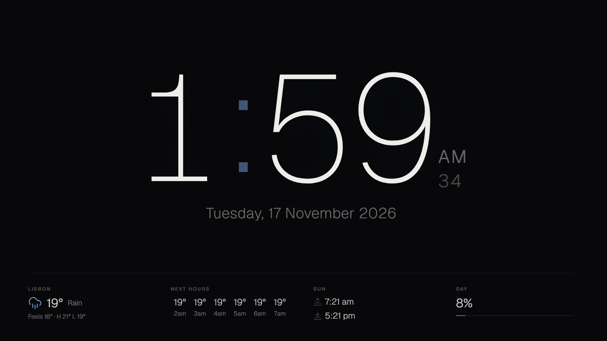
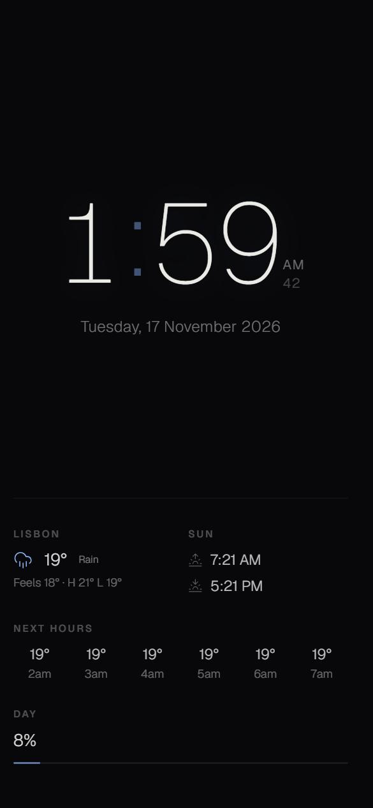

<div align="center">

# Desk Clock

**A calm clock for the screen you're not using.**

A full-screen clock for a spare monitor, tablet or old phone, with local weather, sunrise and sunset, and your next meeting. It's free, needs no sign-up, and the clock keeps working when the internet doesn't.

[**Open it → clock.chinmayraj.tech**](https://clock.chinmayraj.tech)

<br />



</div>

## Why

Most clock websites are noisy, full of ads, or built for a glance. Desk Clock is built to stay on a screen all day. The clock is readable from across the room, every element earns its place, and nothing moves unless it has to.



## Features

- **A clock that doesn't jitter.** Thin Geist digits with fixed-width numerals, timed to the exact second boundary so it never drifts. A soft fade marks each new minute.
- **Weather where you are.** Current conditions, feels-like, high and low, and the next six hours, from [Open-Meteo](https://open-meteo.com). No API key is needed, and the weather refreshes every 15 minutes. If a fetch fails, the last good data stays on screen with a quiet "stale" note.
- **Your next meeting.** Paste a calendar's iCal link and one quiet line appears under the date: *Design review · in 8 min*. Repeating events, timezones and moved meetings are all handled.
- **Sunrise, sunset and day progress.** The background tint shifts slowly through dawn, day, dusk and night while staying near-black.
- **Show only what you want.** Turn seconds, date, calendar, weather, next hours, sun and day progress on or off. Hide every weather widget and the page stops asking for your location.
- **Made to stay on.**
  - Keeps the screen awake (Screen Wake Lock).
  - Shifts the layout a few pixels every 3 minutes to protect against burn-in.
  - Hides the cursor after 3 seconds.
  - Opens fullscreen in one keypress.
- **Phones and tablets.** The layout reflows for portrait screens. Tap the clock for 12h/24h and the temperature for °C/°F. *Add to Home Screen* launches it fullscreen.
- **Everything is local to you.** Time, timezone and location all come from your own device, so it's right wherever you open it.

<br clear="right" />

## Using it

Open [clock.chinmayraj.tech](https://clock.chinmayraj.tech) and allow location when the browser asks. If you decline, it falls back to an approximate city based on your IP address.

| Key | Action |
| --- | --- |
| `F` or double-click | Toggle fullscreen |
| `S` or the sliders button (top left) | Settings: show or hide widgets, units, calendar |
| `T` or tap the clock | 12h / 24h |
| `U` or tap the temperature | °C / °F |

Settings are saved in your browser. There's no account and nothing to sync.

**On a spare Windows PC**, run it as a kiosk:

```bash
start msedge --kiosk https://clock.chinmayraj.tech --edge-kiosk-type=fullscreen
```

**On a phone or tablet**, use *Share › Add to Home Screen* (iOS) or *Install app* (Android). It then opens fullscreen, without the browser bars.

### Adding your calendar

1. Copy your calendar's **secret iCal address**:
   - **Google Calendar:** Settings › *your calendar* › Integrate calendar › *Secret address in iCal format*
   - **Outlook:** Settings › Calendar › Shared calendars › Publish a calendar › *ICS* link
   - **Apple iCloud:** share the calendar publicly and copy the `webcal://` link
2. Paste it into **Settings › Calendar address** and press Enter.

The line under the date shows the meeting in progress, otherwise the next one within 12 hours, otherwise today's all-day event (a holiday, say). It refreshes every 10 minutes.

## Privacy

Desk Clock has no accounts, analytics or cookies, and no database.

| Data | Where it goes | Why |
| --- | --- | --- |
| Your location | [Open-Meteo](https://open-meteo.com) (coordinates) and [BigDataCloud](https://www.bigdatacloud.com/free-api/free-reverse-geocode-to-city-api) (to name the city) | Weather and the city label |
| Your IP address | [GeoJS](https://www.geojs.io), only if you decline location | Approximate city as a fallback |
| Your calendar link | This site's `/api/calendar` route, which fetches the feed and returns the next events | Calendar feeds can't be fetched from the browser directly (CORS) |

The calendar link is stored only in your browser. It's sent in the request body, so it stays out of URLs and server logs, and the server keeps nothing. The proxy accepts only `https://` or `webcal://` addresses on port 443. It refuses private and internal addresses, redirects to them, and feeds over 5 MB.

## Running it yourself

You'll need Node.js 20+.

```bash
git clone https://github.com/chinmayraj28/clock-screen-saver.git
cd clock-screen-saver
npm install
npm run dev          # http://localhost:3000
```

For an always-on machine, use a production build instead:

```bash
npm run build
npm start            # serves on port 3000 on every network interface, so other devices on your LAN can open it too
```

Press `Ctrl+C` to stop the server, and run `npm start` again to restart it. To reach it from another device, run `ipconfig` (or `ip addr` on Linux/macOS) to find this machine's address and open `http://<that-ip>:3000`. Screen Wake Lock only works over `https://` or on `localhost`.

### Configuration

Defaults live in [`app/config.ts`](app/config.ts):

| Setting | Default | What it does |
| --- | --- | --- |
| `location` | `null` (auto-detect) | Pin a city, for example `{ name: "Paris", lat: 48.8566, lon: 2.3522 }` |
| `fallbackLocation` | London | Used when both location and IP lookup fail |
| `units` | `"C"` | `"C"` or `"F"` |
| `hour12` | `"auto"` | `"auto"` follows the browser locale; `true` or `false` forces one |
| `accent` | `#8ab4f8` | The single accent color (colon, icons, progress bar) |

Choices made in the Settings panel override these defaults in that browser.

### Deploying

This repo deploys to [Vercel](https://vercel.com) as-is. Every push to `master` goes to production, and other branches get preview URLs. You can also deploy by hand:

```bash
npx vercel deploy --prod
```

Open-Meteo's free tier is for non-commercial use, with a limit of 10,000 calls per day per IP. Weather is fetched from each visitor's browser, so the limit applies per visitor, not per site.

## How it's built

- **[Next.js](https://nextjs.org) 16** (App Router, Cache Components), **React 19**, **TypeScript**, **Tailwind CSS 4**
- **[Geist](https://vercel.com/font)** font via `next/font`
- **[ical.js](https://github.com/kewisch/ical.js)** is the only runtime dependency beyond Next and React. It expands repeating events, timezones and exceptions in calendar feeds
- No UI kit, chart library or state library. The settings panel uses the native Popover API

```
app/
  dashboard.tsx         the whole clock UI (client component)
  config.ts             defaults: location, units, 12h/24h, accent
  site.ts               name, URL and description used by the metadata
  api/calendar/
    route.ts            iCal proxy with SSRF guards
    ics.ts              feed parser: next events in a time window
  opengraph-image.tsx   social share image, rendered with next/og
  apple-icon.tsx        home-screen icon for iOS
  manifest.ts, robots.ts, sitemap.ts, icon.svg
scripts/check-ics.ts    parser self-check (npm run check)
```

A few details worth knowing:

- **No drift:** the clock re-arms a single timer at each second boundary through `useSyncExternalStore`, rather than trusting `setInterval`.
- **No hydration mismatch:** the page is prerendered on the server, and Vercel's servers run in UTC. Until the browser takes over, the page shows fixed placeholders, then the real time in your timezone.
- **Calendar parser check:** `npm run check` covers repeating events across a timezone, skipped dates (EXDATE), moved occurrences, all-day events and cancelled events.

## Credits

Weather by [Open-Meteo](https://open-meteo.com) (CC BY 4.0). City names by [BigDataCloud](https://www.bigdatacloud.com). IP-based location by [GeoJS](https://www.geojs.io). Weather icons are adapted from [Lucide](https://lucide.dev) (ISC). The [Geist](https://vercel.com/font) font is under the SIL Open Font License.

## License

[MIT](LICENSE). Use it, fork it, put it on your own spare screen.
